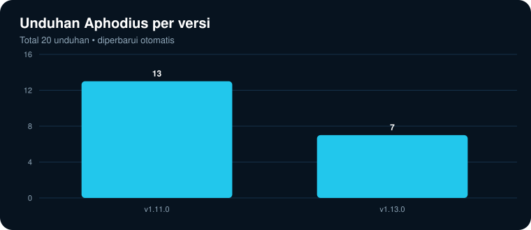

  

<h1 align="center">Aphodius</h1>

<b>Nonton film dan series favoritmu dalam satu aplikasi yang rapi, cepat, dan tanpa ribet.</b>

  
  
  

  <a href="https://github.com/efendiyhy/Aphodius/releases/latest"><b>⬇️ Unduh Aplikasi (APK)</b></a>

---

## Apa itu Aphodius?

Aphodius adalah aplikasi nonton untuk Android. Koleksi film dan series ditampilkan seperti aplikasi streaming pada umumnya: ada poster, sinopsis, rating, dan kategori. Cukup buka, pilih judul, lalu putar layar penuh.

Daftar film **selalu diperbarui otomatis**. Judul baru yang ditambahkan akan muncul sendiri di aplikasimu, tanpa perlu memasang ulang.

## Fitur Utama

### 🎬 Menjelajah dengan mudah
- **Beranda** berisi sorotan film, *Lanjutkan Menonton*, *Rekomendasi untukmu*, *Populer*, dan *Baru Ditambah*.
- **Movie dan Series** bisa dikelompokkan berdasarkan **genre, negara, atau tahun**.
- **Pencarian** cepat berdasarkan judul, negara, tahun, atau genre.
- Setiap poster dilengkapi **judul** di bawahnya, jadi mudah dikenali.
- Halaman detail menampilkan **sinopsis, rating, negara, dan genre**.

### 📺 Series dan episode
- Daftar episode lengkap dengan penanda progres.
- **Lanjut dari episode terakhir** yang kamu tonton.
- Selesai satu episode, episode berikutnya siap diputar.

### ▶️ Pemutar yang nyaman
- Putar layar penuh, ketuk dua kali di kiri atau kanan untuk **mundur atau maju 10 detik**.
- Geser di sisi kiri untuk **kecerahan** dan di sisi kanan untuk **volume**.
- Pilih **kualitas** dan **kecepatan** putar.
- **Crop video** untuk membuang bingkai hitam di tepi. Ada tombol **Auto** yang mengenalinya sendiri.
- **Lanjut menonton** otomatis dari menit terakhir.

### 🔊 Suara ala bioskop
- **Surround bioskop** untuk suara yang terasa lebih luas.
- **Equalizer** sederhana dengan beberapa pilihan siap pakai.

### ⭐ Daftarku
Simpan film yang ingin kamu tonton nanti dalam satu daftar pribadi.

### 🔒 Privasi dan keamanan
- **Kunci aplikasi** dengan PIN 4 digit, bisa ditambah **sidik jari**.
- Profil pribadi: nama sapaan dan foto profil.
- Konten tertentu disembunyikan secara bawaan dan baru tampil setelah kamu mengaktifkannya dengan sandi.

### 🔄 Selalu terbaru
Aplikasi memberi tahu saat ada versi baru. Unduh dan pasang langsung dari dalam aplikasi.

## Cara Memasang

1. Buka halaman **[Rilis](https://github.com/efendiyhy/Aphodius/releases/latest)** lalu unduh file `.apk` terbaru.
2. Buka file tersebut di HP Android. Jika diminta, izinkan *pasang dari sumber ini*.
3. Buka Aphodius, isi nama sapaan, dan selamat menonton.

> Butuh Android 8.0 atau lebih baru.

## Statistik Unduhan

  

## Riwayat Pembaruan

<b>v1.6.0</b> — Extraordinary dan profil baru

- Menu **Extraordinary** yang dibuka dengan sandi. Isinya terpisah dan menggantikan Daftarku.
- Profil ditata ulang lebih rapi, info developer ada di bagian bawah.
- Judul kategori di Beranda kini berwarna putih agar jelas dibaca.

<b>v1.9.0</b> — Pemutar lebih lengkap, Nobar lebih seru

- Kolom cari di Beranda, Movie, dan Series. Tarik ke bawah di Beranda untuk muat ulang, lengkap dengan jumlah film baru.
- Tanda *Selesai* di poster, tombol *Mulai dari awal*, urutan Daftarku (terbaru, abjad, terakhir ditonton), dan *Hapus dari Lanjutkan* dengan tekan-lama.
- Halaman *Riwayat tontonan* di Profil, bisa hapus satu atau semua.
- Pemutar: tombol Berikutnya memilih film sejenis dan menampilkan judulnya dulu, kunci rotasi, durasi lompat 5/10/30 detik, timer tidur, petunjuk gestur, dan tahap memuat yang jelas.
- Hemat data: kualitas default 480p khusus data seluler.
- Nobar: reaksi emoji melayang, status siap/buffering tiap peserta, tombol *Tunggu semua siap*, dan host bisa mengeluarkan peserta.
- Pesan error lebih mudah dipahami, banner saat offline, layar kosong dengan langkah jelas, poster dengan placeholder, tata letak dua kolom di tablet, dan jeda tenggang 45 detik sebelum PIN mengunci lagi.
- Teks lebih besar dan kontras lebih kuat, mengikuti ukuran font sistem. Area sentuh tombol minimal 48dp.

<b>v1.7.0</b> — Nonton bareng (Nobar)

- Buat ruangan dari halaman film atau langsung dari pemutar (tombol kanan atas), bagikan kode 6 karakter, maksimal 4 orang.
- Putar, jeda, dan geser waktu tersinkron untuk semua anggota. Host bisa mengizinkan semua orang ikut mengendalikan.
- Chat dan suara langsung (tekan tombol mikrofon sendiri). Surround bioskop dimatikan sementara saat suara aktif.
- Film dewasa dan Extraordinary tetap bisa dinobarkan; anggota perlu fitur itu aktif di profilnya.
- Keyboard chat tetap terbuka setelah mengirim pesan.
- Keluar dari ruangan tidak menutupnya: ruangan tetap aktif sampai host menutupnya, dan bisa dilanjutkan dari riwayat.
- Chat di pemutar tampil sebagai panel di kanan (video bergeser), atau pesan melayang transparan saat layar penuh.
- Kunci layar di pemutar agar tidak tersentuh saat menonton.
- Nobar untuk series belum tersedia.
- Pengaturan *Poster dari video*: film tanpa poster memakai gambar dari tengah videonya.

<b>v1.5.0</b> — Series, negara, dan rekomendasi

- Tab **Series** dengan daftar episode.
- Film dikelompokkan per genre, negara, atau tahun.
- Bagian *Rekomendasi* dan *Populer*.
- Judul film tampil di bawah poster. Tombol Bagikan dihapus.

<b>v1.4.0</b> — Suara dan personalisasi

- Surround bioskop dan equalizer.
- Crop otomatis, foto profil, dan font baru.

<b>v1.3.x</b> — Tampilan baru dan sinkron lebih cepat

- Desain baru di semua layar dengan logo kumbang.
- Fitur Adults dengan sandi dan kunci aplikasi.
- Pembaruan daftar film jauh lebih cepat.

<b>v1.2.x dan sebelumnya</b>

- Nama sapaan, profil, dan kunci aplikasi PIN.
- Crop manual, sinopsis film, dan pembaruan langsung dari dalam aplikasi.

## Untuk Developer

Aplikasi dibangun dengan Kotlin dan Jetpack Compose. Rilis dibuat otomatis oleh GitHub Actions setiap kali `version.txt` dinaikkan di cabang `main`. Aset logo ada di `branding/`, mockup desain di `portrait/` dan `landscape/`.

---

Dibuat oleh <b>SengkuniDeveloper</b>

